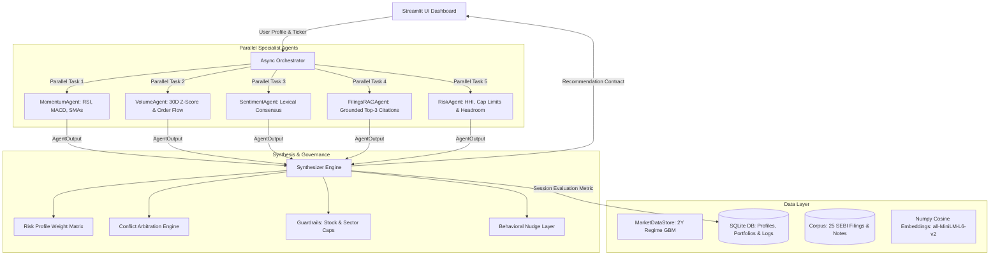

# 🏛️ VibeFinance Architecture & Technical Specification

## 1. System Overview & Data Flow

VibeFinance is an offline-first, explainable multi-agent system built to evaluate Indian equities (NSE) for retail investors. The system executes an asynchronous fan-out fan-in pattern where five specialist agents audit technical indicators, order volume, news sentiment, regulatory disclosures, and portfolio concentration in parallel.



---

## 2. Core Agent Contracts (Pydantic v2)

All specialist agents conform to a single immutable contract:

```python
class AgentOutput(BaseModel):
    agent: str            # Specialist identifier
    ticker: str           # NSE Ticker symbol
    label: str            # Semantic classification (e.g., 'Accumulation', 'Strong Bullish')
    score: float          # Bounded [-1.0, 1.0]
    confidence: float     # Bounded [0.0, 1.0]
    reasoning: List[str]  # Human-readable step-by-step reasoning
    evidence: List[Dict[str, Any]] # Structured evidence: [{source_id, snippet}]
    status: str           # 'ok' | 'degraded' | 'failed'
    latency_ms: float     # Execution runtime
```

---

## 3. Profile-Specific Weight Tables

To mirror institutional wealth management practices, agent votes are weighted according to the investor's fiduciary profile:

| Agent | Conservative Retiree | Balanced Wealth Builder | Aggressive Momentum Trader | Rationale |
| :--- | :---: | :---: | :---: | :--- |
| **RiskAgent** | **35%** | 25% | 10% | Capital preservation & concentration control |
| **FilingsRAGAgent** | **30%** | 25% | 10% | Statutory disclosures & audit observations |
| **SentimentAgent** | 15% | 15% | 15% | Media & institutional consensus |
| **MomentumAgent** | 10% | 20% | **35%** | Trend acceleration & technical breakout |
| **VolumeAgent** | 10% | 15% | **30%** | Liquidity surges & accumulation signals |
| **Sum** | **100%** | **100%** | **100%** | Validated mathematical partition |

**Effective Composite Score Formula:**
$$S_{composite} = \frac{\sum_{i=1}^5 w_i \cdot \text{conf}_i \cdot \text{score}_i}{\sum_{i=1}^5 w_i \cdot \text{conf}_i}$$

*Note: If an agent fails (`status == "failed"`), its confidence is 0.0, meaning its effective weight in the score is 0.0, and it cannot skew the ensemble.*

---

## 4. Conflict Arbitration & Signal Friction

When two agents produce diametrically opposed high-confidence signals ($\text{confidence} \ge 0.60$, opposite directional scores $|score| > 0.20$):
1. **Detection:** Identified by pairwise matrix search (e.g., technical breakout vs negative statutory risk).
2. **Confidence Penalty:** Overall recommendation confidence is discounted by 15% to reflect unresolved friction.
3. **Resolution Rule:** The agent with higher profile weighting prevails, and an explicit arbitration note is appended to the reasoning chain.

---

## 5. Risk Guardrails & Behavioral Nudges

### Hard Portfolio Guardrails
- **Single-Stock Cap:** If adding the proposed position pushes the stock's portfolio weight above `user.max_stock_weight` (e.g., 10% for Conservative), the action is immediately forced to **`AVOID`** (or `HOLD`/`REDUCE` if already owned).
- **Sector Ceiling:** If total exposure to a sector exceeds `user.sector_cap` (e.g., 25% for FMCG), the allocation is blocked and the intercept rule is displayed in red.

### Behavioral Nudges
- **Overtrading Detection:** Flagged if `user_decisions` contains $>10$ transactions in 30 days. Triggers a mandatory 24-hour cooling-off advisory.
- **Panic Selling Mitigation:** Flagged if user has historical sales following short-term intraday dips. Reminds user to focus on fundamental earnings rather than market noise.

---

## 6. Evaluation Methodology & Backtest

### Walk-Forward Directional Backtest
- **Framework:** Non-overlapping forward returns over simulated 2-year history across 5 historical observation points per ticker (60 sample points).
- **Zero Lookahead:** All indicators (RSI14, MACD, SMAs, Vol Z-Score) are strictly recomputed on historical price slices up to prediction timestamp $t$.
- **Ground Truth Target:** Directional sign of 30-day forward return:
  $$\text{Target} = \text{sign}\left(\frac{\text{Close}_{t+30} - \text{Close}_t}{\text{Close}_t}\right)$$
- **Sample Accounting:**
  $$\text{Valid Observations} = \text{Directional Calls} + \text{Neutral Uncommitted Checkpoints}$$
  $$\text{Directional Calls} = \text{Correct Predictions} + \text{Incorrect Predictions}$$
- **Comparative Baseline:** Evaluated against a naive majority-class directional predictor, measuring directional edge above the dominant market drift.
- **Dataset Disclosure:** Evaluated on a 3-state Markov regime-switching Geometric Brownian Motion (GBM) with injected event shocks for research benchmarking.

---

## 7. Hackathon Judging Matrix Mapping

| Hackathon Judging Criterion | Where & How It Is Satisfied in VibeFinance | Source Reference |
| :--- | :--- | :--- |
| **1. Working End-to-End Demo** | 1-command startup (`streamlit run app.py`), full interactive analysis, 3 seeded users, and instant 1-click scripted demo. | [app.py](file:///c:/Users/rajks/OneDrive/Desktop/VibeFinance/app.py) |
| **2. Visible Reasoning & Citations** | Every claim has a source tag (`[doc_id \| section \| date]` or `[MOM_RSI14]`). 100% citation coverage ledger with zero fabricated citations on missing filings. | [synthesizer.py](file:///c:/Users/rajks/OneDrive/Desktop/VibeFinance/synthesizer.py) |
| **3. Offline & Seeded Constraints** | Fully offline. Numpy cosine search over cached `all-MiniLM-L6-v2` embeddings. Deterministic random seed 42. | [rag.py](file:///c:/Users/rajks/OneDrive/Desktop/VibeFinance/rag.py) |
| **4. Parallel Multi-Agent Ensemble** | 5 specialist agents executed concurrently via `asyncio.gather`. Measurable **4.7x speedup** vs sequential. | [agents.py](file:///c:/Users/rajks/OneDrive/Desktop/VibeFinance/agents.py) |
| **5. Personalization & User Profiles** | 3 distinct SQLite investor personas. "Compare Profiles" view running same ticker side-by-side with diverging recommendations. | [users.py](file:///c:/Users/rajks/OneDrive/Desktop/VibeFinance/users.py), [test_stage4_synthesizer.py](file:///c:/Users/rajks/OneDrive/Desktop/VibeFinance/tests/test_stage4_synthesizer.py) |
| **6. Behavioral Nudges & Guardrails** | Cooling-off periods for overtrading; hard blocks on single-stock and sector limits with rule disclosure. | [synthesizer.py](file:///c:/Users/rajks/OneDrive/Desktop/VibeFinance/synthesizer.py) |
| **7. Failure Mode Resilience** | 8 automated failure scenarios (price feed down, missing filings, signal conflicts, timeouts, exceptions, RAG init failure, all agents failing). | [test_stage7_failures.py](file:///c:/Users/rajks/OneDrive/Desktop/VibeFinance/tests/test_stage7_failures.py) |
| **8. Quantitative Evaluation** | Walk-forward backtest with baseline comparison, live session vs precomputed demo benchmarks, and HHI shifts logged in SQLite. | [evalmetrics.py](file:///c:/Users/rajks/OneDrive/Desktop/VibeFinance/evalmetrics.py) |
